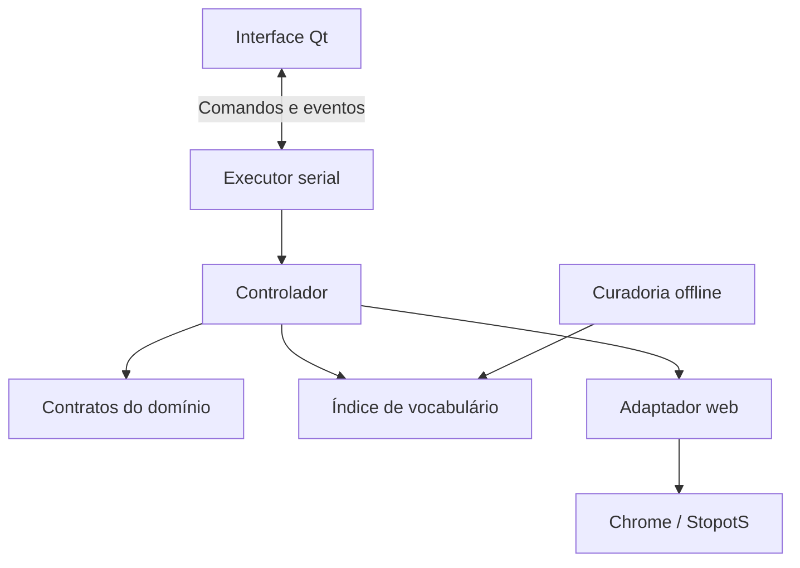

# Arquitetura

O aplicativo é um processo Python com interface Qt, executor serial e adaptador
Playwright. O vocabulário é carregado no início da execução e consultado em
memória; a seleção de palavras não depende de uma consulta externa durante a
rodada.

## Componentes

| Componente | Responsabilidade |
| --- | --- |
| `domain.py` e `identity.py` | Fases, contexto, observações e resultados imutáveis |
| `application.py` | Planejamento, política de ajuda, pausa e execução serial |
| `adapters/snapshot.js` e `web.py` | Leitura da interface, seletores, interação e confirmação |
| `adapters/chrome_session.py` | Processo Chrome dedicado, perfil e reconexão local |
| `adapters/invitation.py` e `entry.js` | Entrada por convite, senha e erros do formulário |
| `desktop_model.py` | Perfis, preferências permitidas e dados do convite |
| `desktop.py` e `desktop_engine.py` | Janela, fila de comandos, sinais e ciclo de vida |
| `ui/` e `ui_surface.py` | Telas Qt Quick e superfícies vetoriais |
| `vocabulary.py` | Taxonomia, índice, edição e publicação dos dados |
| `cli.py` | Comandos de execução, controle e curadoria |

Os módulos estão em [src/stopots_v2](../src/stopots_v2/). O domínio e a curadoria
não importam Playwright. Os seletores ficam no adaptador.

## Concorrência e controle

A janela opera na thread Qt. O executor usa outra thread com event loop próprio
para o Playwright. Comandos entram por uma fila; observações voltam por sinais.
A interface não acessa diretamente os objetos do navegador.

Uma mudança de permissões tem número de revisão e confirmação do executor.
Enquanto a revisão não foi aplicada, a janela mostra Aplicando…. A política
vale para as próximas ações, mantendo a memória das ações já enviadas. Pausar
suspende novas mutações; retomar exige uma observação atual do jogo.

## Contexto e ações

O contexto distingue sessão, sala, partida, rodada e etapa de apuração. A letra
pode repetir e não serve como identidade da rodada. A revisão estrutural da UI
inclui alterações relevantes de formulário e regras; cronômetro e texto
digitado não geram, por si sós, uma nova identidade estrutural.

Cada ciclo observa a interface, planeja uma ação, revalida suas condições,
executa e procura o efeito. Navegação, desconexão e mudança de contexto
invalidam planos anteriores. O formulário precisa estabilizar antes de receber
ações. Uma interface externa não oferece atomicidade entre leitura e clique;
a revalidação reduz essa janela, sem eliminá-la.

| Resultado | Significado |
| --- | --- |
| `APLICADA` | O efeito foi confirmado |
| `JA_SATISFEITA` | O estado desejado já estava presente |
| `OBSOLETA` | O contexto ou alvo mudou |
| `BLOQUEADA` | Uma condição necessária não foi satisfeita |
| `INDETERMINADA` | A confirmação não permitiu concluir o resultado |
| `FALHOU` | Houve falha identificada na execução |

Uma confirmação indeterminada não autoriza repetir automaticamente o clique.
STOP e avanço usam identidade por contexto e tipo de ação; confirmação da
apuração também distingue sua etapa. Mudar o seletor não cria uma nova
permissão para repetir um controle já enviado.

## Contratos do adaptador

Campos da rodada, pool de temas e grupos da apuração são coleções independentes.
Painéis podem coexistir durante animações. A leitura identifica o painel ativo
e espera coleções estáveis, sem assumir uma quantidade fixa de campos.

O preenchimento preserva valores existentes e confere o valor imediatamente
antes de escrever. O voto expressa o estado desejado da seleção, evitando uma
alternância cega. A avaliação distingue resposta compatível, incompatível e
desconhecida; ausência no índice mantém a incerteza semântica.

STOP depende da habilitação observada e das condições da política. Uma recusa
conhecida por campos incompletos pode ser reconhecida somente após a tentativa
própria, na mesma rodada, com um único controle de confirmação. Avisos
desconhecidos, anteriores ou ambíguos suspendem as ações.

Resultados distinguem pódio, linhas visíveis e alcance desconhecido. O placar
da rodada é vinculado ao número do ranking correspondente, pois o contador
geral pode adiantar durante uma transição. Exibir três posições do pódio não
comprova um ranking completo de todos os participantes.

## Sessão Chrome e convite

ChromeSession mantém o processo Chrome independente do driver. O perfil é
exclusivo, e a reconexão exige um endpoint local associado ao identificador do
próprio perfil. Fechar a janela desanexa o executor; fechar o navegador é uma
ação explícita. Fim de partida e reabertura deixam a ajuda pausada.

A senha do convite é tratada como valor opaco, sem remoção de espaços,
conversão de caixa ou normalização Unicode. O campo não participa da
persistência de preferências nem da representação dos dados do convite. O
formulário de senha é identificado separadamente de controles que coexistem
ao fundo.

## Vocabulário

Lexemas, associações semânticas, fontes e decisões de revisão são separados.
Somente associações aprovadas entram no arquivo distribuído. Aliases expressam
equivalência explícita; relações de inclusão são direcionais e ciclos são
rejeitados. Objeto e Presente, por exemplo, não são aliases universais.

A publicação valida o documento, gera manifesto e checksum, substitui o
arquivo atomicamente e preserva a versão anterior. Cada processo fixa a versão
carregada. A busca respeita idioma, categoria, inicial e limite do campo,
medido em unidades UTF-16 após a transformação prevista para o input.

Veja [vocabulário](VOCABULARIO.md), [desenvolvimento](DESENVOLVIMENTO.md) e
[validação](VALIDACAO.md) para os dados, comandos e alcance dos testes.
