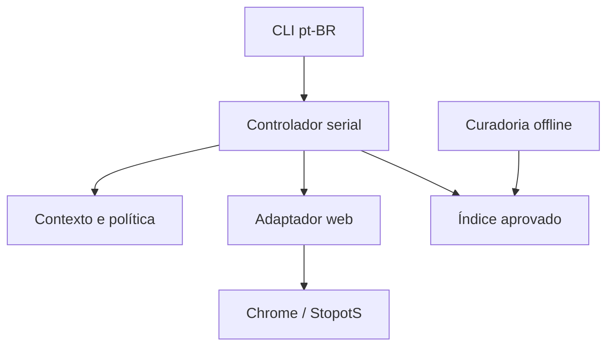

# Arquitetura implementada — v2 em desenvolvimento

Data de referência: 29/10/2026. A certificação do jogo real é registrada separadamente em VALIDACAO.md.

O programa é um processo local. Domínio, planejamento e dados não importam Playwright. O adaptador web concentra seletores, visibilidade, foco, normalização observada e pós-condições. Não há serviço remoto, LLM ou requisição de dicionário durante a rodada.

| Módulo | Responsabilidade |
| --- | --- |
| `domain.py` | Contratos imutáveis, fases, capacidades observadas e resultados de ação |
| `identity.py` | Identidades locais e estabilidade estrutural da UI |
| `application.py` | Política explícita, executor serial, pausa, deduplicação e eventos |
| `adapters/snapshot.js` | Leitura do DOM renderizado, sem estado interno do aplicativo |
| `adapters/web.py` | BrowserPort, precondições, interação normal e confirmação |
| `vocabulary.py` | Taxonomia, importação, curadoria, publicação e índice aprovado |
| `cli.py` | Comandos, configuração TOML e ciclo de vida dos recursos |

Cada ciclo observa, planeja uma ação, revalida o contexto e o valor imediatamente anterior, executa e confirma. O domínio distingue aplicada, já satisfeita, obsoleta, bloqueada, indeterminada e falhou. Timeout após envio não autoriza repetição automática. O ledger do adaptador protege inclusive chamadas que não passam pelo controlador.

`session_id`, épocas de sala, partida, rodada e revisão identificam o contexto local. O índice de rodada é lido da UI; a letra pode repetir. `ui_revision` inclui mudanças de estrutura e regras, e exclui cronômetro e valores digitados. Navegação e perda de conexão invalidam planos. Um formulário precisa estabilizar antes de gerar ações; não há total fixo de campos. Não existe atomicidade garantida na UI de terceiros: a revalidação reduz, mas não elimina, a janela entre leitura e interação.

Campos da rodada, pool de temas e grupos da apuração são coleções independentes. Ações de revisão usam referências do DOM corrente, contador e tema. Votos são definidos por estado desejado; resposta desconhecida preserva a decisão da interface. O programa não usa ausência no índice como prova de erro semântico.

O supervisor separa ativo, pausado, desconectado e recuperando da fase do jogo. A pausa suspende mutações. A recuperação tem prazo limitado e observa a interface; não recarrega automaticamente uma partida nem reenvia planos antigos. O usuário pode fechar a página ou encerrar o programa; o contexto dedicado é fechado em `finally`.

Os dados editoriais mantêm lexemas, variantes, idioma, sentido opcional e associações com fonte e estado. A publicação é determinística, contém manifesto e checksum, valida antes da substituição atômica e preserva a versão anterior. O runtime carrega uma cópia e fixa sua versão. Dados pendentes não entram na seleção. O índice em memória é por categoria e inicial; o limite é medido após a transformação do input, em UTF-16.

A taxonomia só inclui equivalências explícitas. Relações de inclusão são direcionais e ciclos são rejeitados. Objeto e Presente, Nome e Sobrenome ou Influencer e Celebridade não são aliases universais. Colisões de busca não estabelecem identidade semântica; o campo `sense` permite lexemas distintos.

A embalagem nova utiliza `pyproject.toml`, pacote `src/stopots_v2` e comando `stopots-v2`. A árvore Python e o JavaScript legados permanecem como referência e não são instalados pelo caminho da v2. O adaptador não usa XPath legado, classes com hash, índices globais de resposta ou botões desabilitados para decidir ações.

Referências de API consultadas: [locators](https://playwright.dev/python/docs/api/class-locator) e [actionability](https://playwright.dev/python/docs/actionability). As verificações do Playwright complementam a revalidação do domínio; o retorno de `click` não substitui a leitura do efeito.
