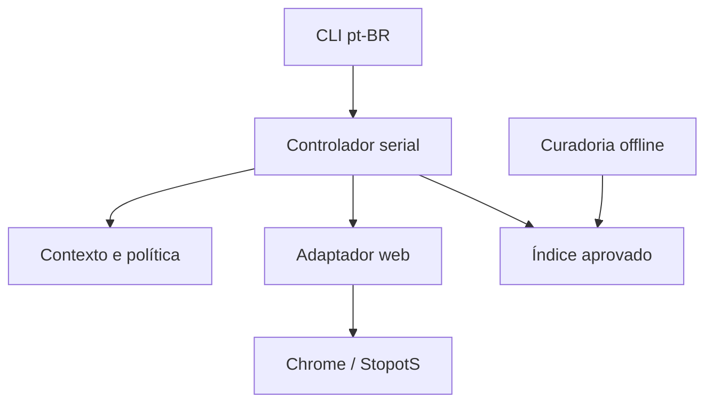

# Arquitetura implementada — v2 em desenvolvimento

Data de referência: 29/10/2026. A certificação do jogo real é registrada separadamente em VALIDACAO.md.

O programa é um processo local. Domínio, planejamento e dados não importam Playwright. O adaptador web concentra seletores, visibilidade, foco, normalização observada e pós-condições. Não há serviço remoto, LLM ou requisição de dicionário durante a rodada.

| Módulo | Responsabilidade |
| --- | --- |
| `domain.py` | Contratos imutáveis, fases, capacidades observadas e resultados de ação |
| `identity.py` | Identidades locais e estabilidade estrutural da UI |
| `application.py` | Política explícita, executor serial, pausa, deduplicação e eventos |
| `adapters/snapshot.js` | Leitura do DOM renderizado, sem estado interno do aplicativo |
| `adapters/web.py` | BrowserPort, precondições, interação normal e confirmação |
| `vocabulary.py` | Taxonomia, importação, curadoria, publicação e índice aprovado |
| `cli.py` | Comandos, configuração TOML e ciclo de vida dos recursos |

Cada ciclo observa, planeja uma ação, revalida o contexto e o valor imediatamente anterior, executa e confirma. O domínio distingue aplicada, já satisfeita, obsoleta, bloqueada, indeterminada e falhou. Timeout após envio não autoriza repetição automática. O ledger do adaptador protege inclusive chamadas que não passam pelo controlador.

`session_id`, épocas de sala, partida, rodada e revisão identificam o contexto local. O índice de rodada é lido da UI; a letra pode repetir. `ui_revision` inclui mudanças de estrutura e regras, e exclui cronômetro e valores digitados. Navegação e perda de conexão invalidam planos. Um formulário precisa estabilizar antes de gerar ações; não há total fixo de campos. Não existe atomicidade garantida na UI de terceiros: a revalidação reduz, mas não elimina, a janela entre leitura e interação.

Campos da rodada, pool de temas e grupos da apuração são coleções independentes. Ações de revisão usam referências do DOM corrente, contador e tema. Votos são definidos por estado desejado; resposta desconhecida preserva a decisão da interface. O programa não usa ausência no índice como prova de erro semântico.

O supervisor separa ativo, pausado, desconectado e recuperando da fase do jogo. A pausa suspende mutações. A recuperação tem prazo limitado e observa a interface; não recarrega automaticamente uma partida nem reenvia planos antigos. O usuário pode fechar a página ou encerrar o programa; o contexto dedicado é fechado em `finally`.

Os dados editoriais mantêm lexemas, variantes, idioma, sentido opcional e associações com fonte e estado. A publicação é determinística, contém manifesto e checksum, valida antes da substituição atômica e preserva a versão anterior. O runtime carrega uma cópia e fixa sua versão. Dados pendentes não entram na seleção. O índice em memória é por categoria e inicial; o limite é medido após a transformação do input, em UTF-16.

A taxonomia só inclui equivalências explícitas. Relações de inclusão são direcionais e ciclos são rejeitados. Objeto e Presente, Nome e Sobrenome ou Influencer e Celebridade não são aliases universais. Colisões de busca não estabelecem identidade semântica; o campo `sense` permite lexemas distintos.

A embalagem nova utiliza `pyproject.toml`, pacote `src/stopots_v2` e comando `stopots-v2`. A árvore Python e o JavaScript legados permanecem como referência e não são instalados pelo caminho da v2. O adaptador não usa XPath legado, classes com hash, índices globais de resposta ou botões desabilitados para decidir ações.

Referências de API consultadas: [locators](https://playwright.dev/python/docs/api/class-locator) e [actionability](https://playwright.dev/python/docs/actionability). As verificações do Playwright complementam a revalidação do domínio; o retorno de `click` não substitui a leitura do efeito.

A normalização de input observada em 29/10/2026 transforma Bem-te-vi em BEM TE VI e D'Ávila em DAVILA. A busca lexical preserva hífen e apóstrofo. A revisão compara grafia e forma de jogo; não reaplica cegamente a transformação ao texto recebido, pois a remoção de pontuação pode criar espaços. O comportamento foi aferido por fill e por teclas e a confirmação do adaptador foi verificada no Chrome.

## Evidência pública da versão 2.0.1

O fluxo JOGAR usa `/pt/game`; a listagem pública também pode abrir caminho numérico. A URL, isoladamente, não identifica visibilidade nem uma sala pública única. Manter invalidação por navegação e fases; não inventar identificador de servidor para a rota compartilhada. Lobby com senha desabilitada não é formulário de entrada.

O botão STOP habilitado não prova aceitação: a UI recusou a ação com categorias incompletas. A política padrão de exigir todos permanece. Na 2.0.1, a sonda registrou confirmação indeterminada e fechou o aviso pela UI. A 2.0.2 implementa a classificação explícita abaixo. Medir tempo mínimo somente com as demais pré-condições satisfeitas.

O final público observado exibiu três posições do pódio. A camada de apresentação deve distinguir linhas retornadas, pódio e ranking completo; não atribuir ao participante controlado um total que a evidência não reconciliou. Valores no formulário não equivalem a ações do pacote: separar capacidade lexical, preenchimento observado e autoria registrada.

O monitor deve aceitar a conclusão explícita da CLI mesmo quando sua observação independente ainda estabiliza. Sucesso do segmento não implica cobertura das rodadas anteriores; manter essa informação nos contratos de evidência. Ver VALIDACAO_PUBLICA.md.

## Revisão 2.0.2

`Observation.notice` carrega somente código, referência e controle de reconhecimento. Enquanto há aviso ativo, o planejador suspende ações. Após uma tentativa própria de STOP, o adaptador reconhece a mensagem específica de categorias incompletas, exige a mesma rodada e um único OK habilitado, fecha esse aviso e retorna `BLOQUEADA` com `attempted=True`. Um aviso que já existia, desconhecido ou ambíguo é preservado. O aviso participa da revisão de contexto para invalidar ações preparadas antes de seu surgimento.

A identidade de STOP e CONTINUAR usa sessão/sala/partida/rodada e tipo; CONFIRMAR também inclui a etapa da apuração. O seletor corrente serve à revalidação e à interação, mas não cria permissão de repetir esses controles quando muda. Tentativas já enviadas, inclusive recusadas ou indeterminadas, são registradas. Campos e votos conservam identidade pelo alvo e estado desejado. A sonda privada encontrou duas solicitações de STOP com seletores diferentes; o contrato de regressão cobre essa mudança de estrutura.

`Ranking.scope` distingue `podium`, `visible_rows` e `unknown`. A extração de FIM DE JOGO! indica pódio; não implica que todos os participantes estejam nessa lista. Os aliases são locais a cada observador, portanto a comparação entre clientes usa os placares; a soma de rodadas e final é conciliada pelos aliases do mesmo cliente.

`tools/review_vocabulary.py` trabalha offline sobre uma cópia validada da fonte editorial. Cada revisão declara checksum de base, identidade, fontes e decisões. O registro de revisão torna a reaplicação exata idempotente; uma revisão divergente ou edição concorrente é rejeitada. Entidades Wikidata exigem revisão e checksum do snapshot, nome confirmado, categoria revisada e idioma compatível. Nenhuma resposta de jogador vira aprovação automática. Publicação mantém a distribuição anterior e não altera a versão carregada por processos em andamento.

O ensaio configurável valida o requisito observado de letras selecionadas pelo menos igual ao número de rodadas, antes de iniciar. A UI oferece no mínimo quatro rodadas no perfil observado. Resultados e restrições desta revisão: [VALIDACAO_CURADORIA.md](VALIDACAO_CURADORIA.md).

## Catálogo e curadoria 2.0.3

A observação pública de temas é ferramenta auxiliar de leitura e fecha cada cliente. Seu relatório separa entrada, tema visto e partida completa; não usa a rota compartilhada como ID de servidor. As definições fornecidas pelo usuário são procedência própria da taxonomia. Revisões adicionam aliases sem substituir categorias existentes; colisões são rejeitadas. PÁF e JLR usam inclusão direcional de categorias componentes, e MSÉ/MST/MSU têm associações próprias.

A revisão em lote faz uma cópia editorial, indexa lexemas/associações, preserva decisões e grafias revisadas e valida antes de escrever. O teste de equivalência mantém o contrato do editor. Snapshots tabulares têm checksum, tabela e categorias permitidas; uma correspondência de nome não autoriza promoção em outra categoria. O runtime continua sem acesso à rede para consultar palavras e fixa a versão carregada. Resultados e lacunas estão em CATALOGO_E_VOCABULARIO.md.
